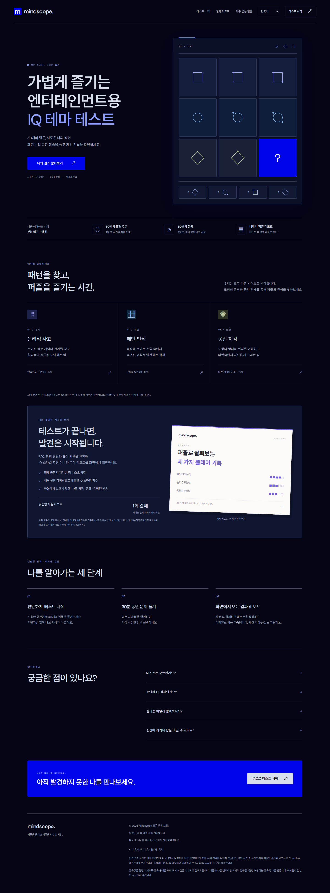

# Noomo UI 비교

브랜치 `design/noomo-inspired-ui` · 기존 디자인 기준 `f7687de` · `main` 미병합

Noomo의 검정·짙은 남색 바탕, 선명한 파랑 CTA, 모노스페이스 메타 정보와 간결한 테두리를 현재 서비스에 맞게 적용했습니다. 홈페이지의 퍼즐 그림은 유지하고, 소개·진행 방법·FAQ를 같은 크기의 카드 반복 대신 번호와 구분선으로 구성했습니다. 시작 안내·문항·타이머·답안·결제 입력·공유 메뉴까지 같은 규칙을 사용합니다.

서비스 문구와 테스트·채점·구매 복원·결제·환불·메일·공유·다국어 로직은 변경하지 않았습니다. 보고서 본문·이메일·사진 저장·공유 이미지의 렌더러와 데이터도 그대로입니다. 밝은 문항 캔버스와 기존 보고서의 글자 크기를 보존했습니다.

## 화면 비교

[기존 전체 화면](noomo-ui/before-desktop.png) · [새 데스크톱](noomo-ui/desktop.png) · [새 모바일](noomo-ui/mobile.png)

[모바일 문항](noomo-ui/mobile-question.png) · [모바일 결제 입력](noomo-ui/mobile-checkout.png) · [모바일 공유 메뉴](noomo-ui/mobile-share.png)

## 검증

- `npm test`: 72개 통과. 새 CSS도 공개 자산 빌드 검증에 포함.
- `npm run build`: 46개 공개 자산 정상 생성.
- Chromium: 1440×1000 한국어, 1280×800 영어, 1024×768 한국어, 768×1024 영어, 390×844 한국어·독일어, 320×740 한국어, 844×390 한국어 확인.
- 가로 넘침, 문항 선택 전 다음 버튼 비활성화, 선택 후 이동, 이전 답안 유지, 창 닫기 후 재개, 성인 확인, 결제 오류 후 재시도 확인.
- 구매 복원·리포트 응답을 가상 처리해 보고서 표시 및 데스크톱·모바일 공유 메뉴 확인. 실제 결제·환불·메일 발송이나 SNS 게시 없음.
- 동일 데이터·760px 너비의 보고서 문서를 같은 배경에서 렌더링해 비교: 기존·새 UI의 스크린샷 바이트 일치.
- Dembrandt MCP `check_contrast`: 본문·보조 글자·CTA·답안·메타 정보 5개 조합 모두 AAA 통과. [측정 결과](noomo-ui/contrast.json)

## 참고 데이터의 범위

[원본 측정값과 적용값](noomo-ui/reference-tokens.json)을 분리해서 기록했습니다. Dembrandt MCP 전체 추출은 무거운 WebGL 사이트에서 완료하지 못해, 원본 CSS와 별도 Chromium computed style로 보완했습니다. 로딩 화면·성능 모니터 컨트롤은 브랜드 규칙에서 제외했습니다. 참고 사이트의 유료 서체·콘텐츠·3D 자산을 가져오지 않았습니다.

## 검토와 복귀

로컬에서 `npm start` 후 `http://localhost:3000/?lang=ko`를 엽니다. 이번 작업 중에는 `http://localhost:3100/?lang=ko`에도 비교용 서버를 실행했습니다. 배포·운영 반영은 하지 않았습니다.

`main`은 기존 디자인을 유지합니다. 작업 트리의 다른 수정사항을 보존한 뒤 `git switch main`으로 돌아갈 수 있습니다. 채택할 때 이 브랜치를 병합하고, 채택 후 되돌릴 때는 디자인 커밋을 `git revert`하면 됩니다.

새 스타일은 `design-ui.css`와 index의 스타일시트 링크로 분리했습니다. 기존 `style.css`, `app.js`, 보고서 템플릿과 서버 기능 구현은 변경하지 않았습니다. `server.mjs`와 빌드 파일은 새 CSS를 제공하는 목록만 확장했습니다.
